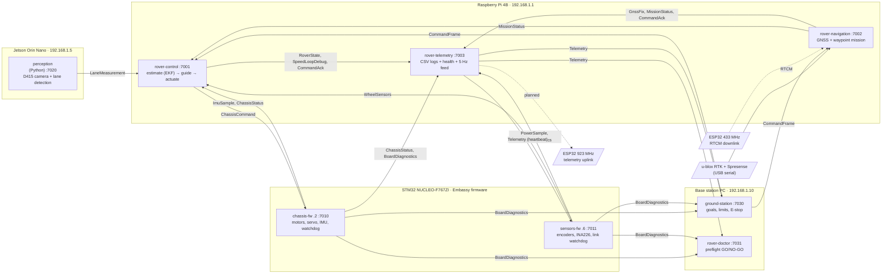

# almondmatcha-rs

Outdoor autonomous rover: vision-based lane following, RTK GNSS waypoint
navigation, and an EKF tying them together. Five machines on one wired LAN,
two of them bare-metal microcontrollers.


> **New here?** [`docs/REWRITE_SUMMARY.md`](docs/REWRITE_SUMMARY.md) is the
> ten-minute version: what this rewrite did, why, what it cost, and what still
> blocks it from driving.

---

## What this repo is

The entire ROS 2 / DDS / mROS 2 stack, replaced with one Rust workspace, two
Rust firmware crates and one Python process for perception. **As of
2026-10-17 nothing here has ever been flashed to a board.**

**There is no middleware.** Messages are plain UDP datagrams on a static LAN,
routed from a table in `config/rover.toml`. No discovery, no QoS negotiation,
no multicast, no broker — and **no TCP anywhere**, because the planned LoRa
base link is one-directional and cannot carry a handshake.

The ROS 2 usage it replaces was thin: 12 topics, one service, one action, no
third-party ROS packages. What it cost was not thin — embeddedRTPS on the two
NUCLEOs needed five local patches and hand-derived RTPS memory pools that had
to be re-checked whenever a node was added *anywhere on the network*, and the
whole MCU toolchain was mbed OS + lwIP + CMake + Docker.

The single biggest structural win: **one repository holds the host binaries
and the MCU firmware, and both build against one shared message crate**
(`rover-msgs`, which the firmware crates take by path — they are separate Cargo
projects, not workspace members), so a wire layout disagreement between the RPi
and an STM32 is a compile error on a laptop rather than a HardFault in a
field.

> **`docs/RUST_REWRITE_PLAN.md` is the design document.** For what actually
> exists today, read `docs/STATUS_DONE.md` (what is built, and the evidence)
> and `docs/STATUS_OPEN.md` (what remains, and what to worry about). Those two
> are authoritative over any status claim in the plan.

---

## Architecture

> **Jetson = perception. RPi = estimation + control. STM32 = actuation and
> sensing. Base station = observability and optional override, never a
> dependency.**

That last clause is load-bearing: once the base moves to the LoRa link, the
rover must complete a mission with **zero uplink**.

```
  Jetson .5              RPi .1                         Base .10
┌────────────┐   ┌──────────────────────┐              ┌──────────────┐
│ perception │   │ rover-control        │   telemetry  │ ground-      │
│  (Python)  │──>│  ├ estimate  EKF     │─────────────>│  station     │
│  camera +  │UDP│  ├ guide  pluggable  │<─────────────│  (Rust)      │
│  lane      │   │  └ actuate  safety   │   commands   └──────────────┘
└────────────┘   ├──────────────────────┤
                 │ rover-navigation     │<-- RTCM --- ESP32 433 MHz (planned)
                 │ rover-telemetry      │----------> ESP32 923 MHz (planned)
                 └──────────┬───────────┘
                            │ UDP over Ethernet
                 ┌──────────┴───────────┐
                 │ STM32 .2  chassis-fw │
                 │ STM32 .6  sensors-fw │
                 └──────────────────────┘
```

The same system as a message graph — every edge is one row of
`config/rover.toml`'s `[routes]` table, labelled with the message type, and
every box is one entry of `[services]`. Dashed lines are the planned LoRa
links.



Every arrow is a self-contained UDP datagram on the wired LAN, built from the
shared `rover-msgs` crate; there is no broker in the middle. Commands are
acknowledged end to end: each consumer's `CommandAck` is folded into
`Telemetry`, and `ground-station` retransmits until it sees it there.

Both LoRa links are **planned, not built** — out of scope on this branch, but
the reason there is no TCP in the design. Machines, sensors, pin maps and
calibration status: [`docs/HARDWARE.md`](docs/HARDWARE.md).

Eight *services* run on five *machines* — the RPi alone runs three processes
that each bind their own UDP port, and the base PC runs two (`ground-station`
and `rover-doctor`). `config/rover.toml`'s `[services]` table
therefore maps a **process** to a `host:port`, not a machine to a port.

---

## The crates

Twelve library and binary crates, two firmware images, one tool. `rover-msgs`
is at the bottom; everything stacks above it.

### The bus — how anything reaches anything

**`rover-msgs`** — the wire contract, shared by every component. Eighteen
message types plus the 4-byte `FrameHeader`, hand-written encode/decode, no
code generation. Fixed-width little-endian, no padding, no variable-length data
anywhere, SI units named in the field. Every type carries a permanent
`TYPE_ID`. It is `no_std` and builds for `thumbv7em-none-eabihf` as well as the
host — the mechanism behind the "single biggest structural win" above.
`testdata/*.bin` holds 26 golden fixtures — the 18 types, the frame header,
and seven variants (five `CommandFrame` bodies, `MissionStatus_NoTarget`,
`LaneMeasurement_Invalid`) — that Rust generates and Python asserts against, so
the two languages provably agree on every byte.

**`rover-link`** — the link layer. `rover-bus` is written against the `Link`
*trait*, not UDP, because the base station will not always be on the LAN:
adding the LoRa serial link later is a new `impl`, not a redesign. Also where
"no TCP" is decided and explained.

**`rover-bus`** — pub/sub and the command protocol, generic over any `Link`. A
stream is unicast fan-out from the static routing table, **newest-wins**: one
slot per message type, a new arrival overwrites it. No queue, so no queue can
grow unbounded behind a slow subscriber. Commands are separate — idempotent
frames carrying a per-process `session` and a `cmd_seq`, retransmitted until
the consumers' own `CommandAck`s come back echoed in `Telemetry`, which is
what makes them safe over a lossy one-way radio. A new session resets the
receiver's ordering, so restarting the base station never leaves the rover
ignoring its commands.

**`rover-tap`** — debug CLI replacing `ros2 topic echo`; per-type rates and
loss inferred from sequence gaps. ⚠️ Unicast fan-out means a tap sees only
traffic addressed to the service it binds as; set `[debug] mirror` to copy
every frame a *host* process publishes to it. The firmware has no mirror, so
`ImuSample`, `WheelSensors`, `ChassisStatus`, `PowerSample` and
`BoardDiagnostics` reach a tap only through the service they are routed to.

**`rover-runs`** — the `run_NNN_<stamp>/` directory convention, shared by
`rover-telemetry` and `ground-station` so two divergent implementations cannot
drift apart.

### The vehicle — model, estimation, control

**`rover-model`** — the linearised lateral error dynamics `A(v)`/`B(v)`. One
model, three consumers (EKF predict today; LQR and MPC later), so estimator and
controller can never quietly disagree about the vehicle.

**`rover-estimator`** — the 5-state EKF, referenced to the **front axle**:
cross-track error, heading error, curvature, speed, gyro bias. IMU yaw rate as
input, camera and odometry corrections behind a chi-square gate, Joseph-form
covariance, and a zero-rate gyro-bias update that runs every time the rover
pauses. On a lane dropout it coasts with growing covariance instead of freezing.

**`rover-control`** (RPi) — **estimate** → **guide** → **actuate**. Guidance is
a `LateralController` trait, so LQR and MPC are new files rather than a
rewrite; `actuate` owns every guard rail — saturation, slew limiting, speed
cap, stall detection, safety gate — because *controllers propose, actuation
disposes*. A library plus a thin binary, deliberately: that is what lets
`tools/replay` drive the **exact** shipping code rather than a lookalike.

### The rest of the rover

**`rover-navigation`** (RPi) — two GNSS receivers on their own threads (u-blox
RTK, Spresense backup), the waypoint mission state machine, and the RTCM
injection point for the 433 MHz link. Three ROS 2 nodes become one process. It
prefers RTK and falls back to the backup — which the ROS 2 mission monitor
never did, a deliberate behaviour change. GNSS fixes expire after 2 s, and a
mission with no usable fix for 5 s pauses (it resumes, it is not cancelled).

**`rover-telemetry`** (RPi) — per-topic CSV at native rates, the 5 Hz
`Telemetry` feed to base, and the health bits that age each inbound feed and
flag a dead one — an estimator that has never been heard from reads as
stale and diverged, never as healthy. One process where ROS 2 used two.

**`ground-station`** (base PC) — mission goals, speed limits, E-stop; live
telemetry; logs what arrives. Commands go out one at a time in FIFO order; an
E-stop discards the queue and pre-empts whatever is in flight. Works over
either link. Read its E-stop notes before wiring it to anything real.

**`rover-doctor`** (base PC) — preflight GO/NO-GO run before driving. Nine
checks; distinguishes "not seen yet" from "seen and bad", and never reports GO
on missing data. It binds its own `doctor` service (`192.168.1.10:7031`), so it
can run beside `ground-station` — and only on the base PC, since it binds that
address.

### Firmware — `no_std` Rust on Embassy

**`firmware/chassis`** (STM32 `.2`) — motor PWM, steering servo, LSM6DSV16X IMU
at 100 Hz, command watchdog (boots tripped, re-armed by `rover-control`).
69,976 B flash (3.3 %), 19,316 B RAM (3.7 %).

**`firmware/sensors`** (STM32 `.6`) — wheel encoders via software 4× quadrature
decode over EXTI (hardware quadrature is impossible on this harness — see
`HARDWARE.md`), INA226 power monitor, link watchdog (an LED, no actuation).
57,476 B flash (2.7 %), 19,360 B RAM (3.7 %).

Both run a power-on self-test and report it, with reset cause and PHY link
state, over `BoardDiagnostics`.

Sizes are `cargo size --release` under the pinned rustc 1.99.1: flash is
`text + data`, RAM is `data + bss`, against 2 MB / 512 KB. (Method and the
`calibration` feature's +656 B / +80 B: `docs/STATUS_DONE.md` §1.)

⚠️ **As of 2026-10-17 neither image has ever run on real hardware.** Both build
and are clippy clean; that is all anyone knows about them.

### Everything else

| Path | What it is |
|---|---|
| `perception/` | Jetson. Camera capture + lane detection in **one** Python process. Stays Python for PyTorch/TensorRT. Sends from its own `[services] perception` address — the receivers drop datagrams from any other source — so a dev host without that IP needs `--bind-any`. Survives per-frame exceptions and reopens a lost camera with backoff before exiting non-zero. `tests/oracle/` holds the ROS 2 detector frozen verbatim as the parity oracle. |
| `tools/replay` | The §12 gate — replays traces through the real control code against a frozen oracle of the old law. Nothing should drive a motor until this passes. |
| `tools/capture_d415_rgb.py` | Standalone D415 capture utility, outside the workspace; useful for test video. |
| `tools/launch_rover_tmux.sh` | Central tmux launcher for the **RPi**: the three rover processes in one titled session, one shared run directory, every pane teed to a log. Does not restart a dead process — a silently restarting `rover-control` would hide the fault. Successor to `ws_rpi/launch_rover_tmux.sh`. |
| `tools/launch_jetson_tmux.sh` | The same for the **Jetson**: perception plus a spare shell. Unlike the RPi script it restarts perception on a non-zero exit (stateless, and a dead perception leaves the rover on gyro + odometry only). |
| `config/rover.toml` | Single source of truth: `[services]`, `[routes]`, gains, noise, safety timeouts, calibration. Nothing here may be duplicated in code. |
| `testdata/*.bin` | Golden wire fixtures. Regenerating them is a breaking protocol change. |
| `ws_spresense/` | Standalone Arduino GNSS sketches. Untouched by the rewrite. |

---

## ⚠️ The sign convention is inverted from ISO 8855

`cross_track_m` and `steer` are positive when the correct response is *steer
right* — the opposite of ISO 8855. This is field-derived and carried over
deliberately: "correcting" it without inverting every consumer in the same
commit turns the lateral controller into positive feedback.

> **`heading_err_rad` is a different matter, and this heading used to hide
> that.** The detector's `theta` was the *negative* of
> `d(cross_track)/d(distance)` while both the EKF's measurement matrix and
> `RoverState::at_lookahead` assume the positive — and because "inverted on
> purpose" reads as covering all three quantities, the disagreement looked
> intentional for months. **Fixed:** `LaneDetector.detect` now negates before
> publishing, and `perception/tests/test_lane_sign_convention.py` checks the
> detector against the model rather than against its own assumption.
> It is a 3.21× increase in steering authority, so it needs a re-tune —
> `docs/RUST_REWRITE_PLAN.md` §13.3b **D5**.

---

## Build and test

```bash
# Rust workspace — host binaries and tools (13 packages: 12 crates + tools/replay)
cargo test --workspace                      # 438 tests
cargo clippy --workspace --all-targets      # clean
cargo fmt --all --check

cargo build --release -p rover-control      # also: -p rover-navigation,
                                            # -p rover-telemetry, -p ground-station

# Firmware — separate targets, so each builds in its own directory
(cd firmware/chassis && cargo build --release)   # thumbv7em-none-eabihf
(cd firmware/sensors && cargo build --release)

# Perception (first time: create the venv the tests expect)
cd perception
python3 -m venv .venv && .venv/bin/pip install -e '.[dev]'
.venv/bin/python -m pytest tests/ -q        # 124 tests

# The parity gate — `run` needs a trace; `synthetic` makes one
cargo run -p replay -- synthetic --out /tmp/trace.csv
cargo run -p replay -- run --trace /tmp/trace.csv   # exit 0 = within tolerance
```

Firmware flashes with `probe-rs`; logs come back over RTT via `defmt`. No
Docker, no CMake, no mbed.

---

## Before this drives

- [x] **Calibrate the drivetrain** (2026-10-26, bench). Procedure A gave
      `ticks_per_rev = 1396` at 4× decoding; `metres_per_tick = 0.0002813`
      comes from the measured 0.125 m wheel, not a rolled distance — re-check
      with Procedure B (`docs/CALIBRATION.md`) once the rover can roll.
      `track_width_m` is still `0.0`.
- [ ] **Bench bring-up in progress** (2026-10-26). The sensors board runs
      and passed its PHY gate, after two firmware fixes the bench found
      (missing interrupt vector table on both boards; swapped encoder
      sides). The chassis board is not yet flashed. The LAN8742A PHY against
      Embassy's `GenericPhy` is the hard gate that decides whether any of the
      firmware is real — plan §13.4 lists the rest of the hardware-verification
      debt, and `docs/STATUS_OPEN.md` §3 the checks the 2026-10-17 audit added
      (gyro z sign, motor enable pins before `Motors::new`, encoder decode
      latency).
- [x] **`heading_err_rad` sign fixed** (plan §13.3b D5). The detector now
      matches the model its output feeds. Regression-tested against the
      geometry, not against its own assumption.
- [ ] **Re-tune after D5.** The fix is a 3.21× increase in straight-line
      steering authority against gains that have never run with a correctly
      signed heading term. Start slow; `config/rover.toml` has the bracket.
- [x] **Camera latency compensated** (plan §13.3b D6). Each `LaneMeasurement`
      carries its capture time and capture-to-publish age; the EKF compares it
      with its belief at capture time and ignores frames older than
      `lane_max_age_ms`. `lane_detection.csv` logs the age and dropped
      frames. Re-tune with it on (`lane_latency_compensation`), alongside D5.
- [ ] **Replay parity is against synthetic traces only.** No recorded ROS 2
      field data exists in this repository and none ever did, so the gate
      compares against a hand-rolled oracle of the old law rather than the
      rover's actual past behaviour. Producing a real baseline now means
      running the old ROS 2 stack, which lives on `main` in
      `RoboticsGG/almondmatcha` — this repository's `origin` has no `main`
      branch at all.

---

## Docs

| File | What it is |
|---|---|
| [`REWRITE_SUMMARY.md`](docs/REWRITE_SUMMARY.md) | **Start here.** What the rewrite did, why, what it cost, what blocks it. |
| [`RUST_REWRITE_PLAN.md`](docs/RUST_REWRITE_PLAN.md) | The design document: architecture, rationale, calibration reasoning (§2.6), defect narratives (§13.3b), hardware-verification debt (§13.4). |
| [`STATUS_DONE.md`](docs/STATUS_DONE.md) | What is built, and the evidence for each claim. |
| [`STATUS_OPEN.md`](docs/STATUS_OPEN.md) | What remains, the risk register reassessed, and open concerns. **Read before planning a field run.** |
| [`FIELD_TEST.md`](docs/FIELD_TEST.md) | How to run a field test end to end, and where the data lands. |
| [`HARDWARE.md`](docs/HARDWARE.md) | Machines, sensors, both pin maps, calibration status. |
| [`CALIBRATION.md`](docs/CALIBRATION.md) | Step-by-step drivetrain encoder calibration: which ST-Link is which board, build/flash commands, Procedures A and B. |
| [`VISION_PIPELINE.md`](docs/VISION_PIPELINE.md) | Camera frame → lane geometry. ROS 2 era, still the reference. |
| [`CONTROL_LAW.md`](docs/CONTROL_LAW.md) | Steering and speed derivation. ROS 2 era — see its banner. |
| [`CSV_LOGGING.md`](docs/CSV_LOGGING.md) | Log schemas and analysis guidance. ROS 2 era. |

The three marked "ROS 2 era" describe the system this branch replaced. They are
kept because the knowledge in them is field-derived and expensive to
regenerate, not because they describe what runs now. Each carries a header
saying so, and where one disagrees with the code, the code is what ships.

### Editing the docs

⚠️ **Some headings, section numbers and sentences in `docs/` are load-bearing:
source code, config comments and tests cite them.** Renumbering or retitling
one leaves a dangling citation that nothing checks — a runtime message an
operator reads can end up pointing at the wrong section. Before touching a
heading in any file below, grep for it:

```bash
grep -rnE "docs/[A-Z_]+\.md|[A-Z_]+\.md|plan (§|sec(tion)? )[0-9]" \
    crates firmware perception tools config \
    --exclude-dir=target --exclude-dir=.venv --exclude-dir=__pycache__
```

(That catches `docs/X.md` paths, bare `X.md` mentions, and the bare
`plan §N` / `plan sec N` shorthand the plain filename grep misses. Counts as of
2026-10-17: 48 explicit `RUST_REWRITE_PLAN` citations in 30 files, plus 108 bare
`plan §N` mentions on 107 lines.) What is cited, and from where:

- **`docs/RUST_REWRITE_PLAN.md`** — by section number, throughout (§2.2, §2.6,
  §4.2, §5.2, §6, §8, §9 step 15, §10, §13.3, §13.3b D1–D6, §13.4, §13.4a, …).
  `rover-doctor`'s drivetrain NO-GO string says "docs/RUST_REWRITE_PLAN.md
  section 2.6" and a test asserts it contains `RUST_REWRITE_PLAN.md` and `2.6`.
  Keep section numbers; add content inside a section rather than a new number.
- **`docs/STATUS_OPEN.md`** — from 6 sites: **§1.1** (`rover-control`'s
  `actuate.rs` and a `config.rs` test, `tools/replay`'s `synthetic.rs`),
  **§1.4** (`rover-control`'s `guide.rs`, `config/rover.toml`), and **§2**'s risk
  table, by row name ("RTK bandwidth over 433 MHz" in `rover-navigation`'s
  `rtcm.rs`, "EKF tuning eats time" in `config/rover.toml`).
- **`docs/CALIBRATION.md`** — `rover-doctor` prints "docs/CALIBRATION.md" in its
  drivetrain NO-GO and a test asserts it; `config/rover.toml` points at
  "Procedure A" and "Procedure B". Keep those names.
- **`docs/CONTROL_LAW.md` §2.1 and §1.7** — by number from `rover-control`'s
  `actuate.rs` (including a runtime `log::warn!` an operator reads) and from
  `perception/rover_perception/lane.py`. §2.1's "16 % / nominal cruise duty"
  table row is hard-coded in `actuate.rs`.
- **`docs/VISION_PIPELINE.md`** — `## 2. Adaptive color segmentation …` and
  `### Regenerating the ROI` are cited from `perception/tests/oracle/config.py`,
  the **frozen** parity oracle, which must not be edited — the doc is the only
  side that can move, so it must not. (`tools/launch_jetson_tmux.sh` also
  cites its `lane_detection.csv` filename contract.)
- **`docs/CSV_LOGGING.md`** — by heading **text** and quoted prose, never by
  number: `## Run Directory Numbering`, `### RPi: mission_state.csv`, and two
  sentences quoted verbatim: "All three write asynchronously: the owning node
  enqueues a row/frame and a background thread drains the queue and writes it to
  disk, so a slow eMMC/SD card never blocks the image-processing or control
  callback" (`rover-telemetry/src/csv_writer.rs`) and "No CSV logging on base
  station (display-only)" (`ground-station/src/csv_log.rs`).
- **`docs/REWRITE_SUMMARY.md` §8** (`rover-control`'s `config.rs`, for "LQR/MPC
  deliberately not implemented") and **`docs/HARDWARE.md` §5** (`config/rover.toml`).

Anything else in `docs/` can be reorganised freely, but run the grep first.
